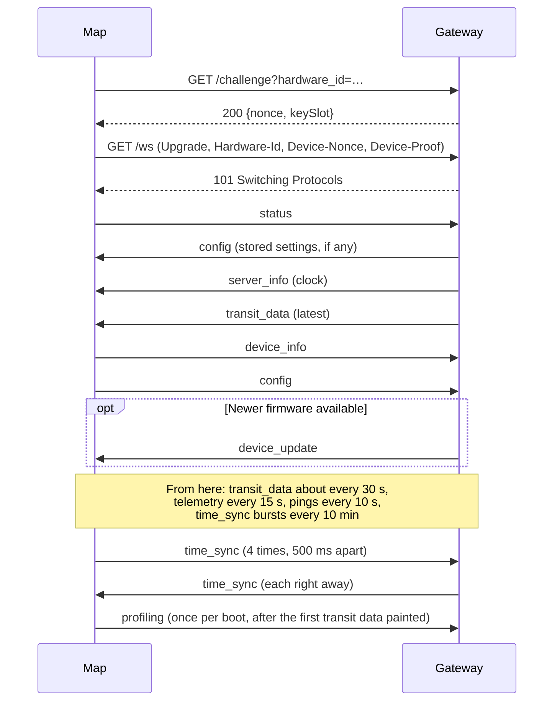

# Client Protocol

How a LEDTransit map talks to the LEDTransit gateway: one long-lived
connection, over which the gateway sends transit data, settings and commands
from the app, and the map reports its status and health. The implementation is
in [`src/net/ws_client/`](../src/net/ws_client/), the messages are defined in
[`ledtransit_client.proto`](../assets/proto_schema/ledtransit_client.proto).

## Protocol stack

| Layer | |
|---|---|
| Messages | Protocol Buffers (proto2): one `ClientMessage` per WebSocket message |
| WebSocket | Binary frames, unfragmented. Subprotocol `ledtransit-client`, path `/ws` |
| HTTP/1.1 | Device authentication, then the WebSocket upgrade, on the same connection |
| TLS | TLS 1.2 (1.3 after a TLS error, see below), server certificate checked against the CA bundle in the firmware ([`ca-bundle.pem`](../assets/certs/ca-bundle.pem)) |
| TCP | `gateway.ledtransit.com:443` |

- **TLS:** the map resumes the previous connection's TLS session when it
  reconnects, which skips most of the handshake (slow on this chip). After a
  failed TLS handshake, the next attempt switches between TLS 1.2 and 1.3
  ([`tls.rs`](../src/net/ws_client/tls.rs)).
- **Version:** each `ClientMessage` carries `version` (currently `1`). The map
  closes the connection on a message with another version, the gateway ignores
  such a message.
- **Keepalive:** the gateway pings every 10 seconds and closes the connection
  if it gets no pong for 30 seconds. The map reconnects if it receives no frame
  for 45 seconds.

## Establishing the connection

1. **Resolve and connect:** DNS lookup of the gateway, TCP, TLS handshake.
2. **Claim** (only the first connection after setup): `GET /challenge`, then
   `POST /claim` with a proof over the challenge and the provisioning token,
   see [WiFi Provisioning](WIFI_PROVISIONING.md#claiming).
3. **Authenticate:** `GET /challenge?hardware_id=…` returns
   `{"nonce": …, "keySlot": …}`. The map computes a proof over the nonce with
   that device key ([`device_auth.rs`](../src/device_auth.rs)).
4. **Upgrade:** `GET /ws` with the WebSocket upgrade headers and
   `Hardware-Id`, `Device-Nonce` and `Device-Proof`
   ([`auth.rs`](../src/net/ws_client/auth.rs)).
5. **Messages:** both sides start sending right away, see below.

The gateway answers the upgrade with:

| Status | Meaning | The map |
|---|---|---|
| `101` | Connected | Starts exchanging messages |
| `401` | Proof invalid, or unknown hardware | Retries after 3 seconds, status LED shows an authentication error |
| `403` | Device blocked | Retries after 3 seconds, status LED shows an authentication error |
| `404` | Not linked to an account (any more) | Goes back into setup mode |
| `429` | Reconnecting too often | Retries after 3 seconds |

A new connection of the same device replaces the previous one, which the
gateway closes.

### First messages

The map sends `status` as soon as the connection is up, independently of what
the gateway sends, and its first `time_sync` once the transit data sent on join
arrived (or after 3 s): a reply would otherwise wait behind it. It answers `server_info` with `device_info` and its
`config`. The gateway checks for a firmware update once it knows the firmware
version from `device_info`.

## Messages

Each WebSocket message is a `ClientMessage` with exactly one `payload`:

| Payload | Direction | When |
|---|---|---|
| `server_info` | Gateway → Map | On connect, hourly, and when the timezone or location changes |
| `device_info` | Map → Gateway | In reply to `server_info` |
| `status` | Both | Map: on connect and on change. Gateway: the light switched in the app |
| `config` | Both | On connect and on change, on either side |
| `device_update` | Gateway → Map | After `device_info`, if newer firmware is available |
| `telemetry` | Map → Gateway | Periodically and on change |
| `command` | Gateway → Map | From the app |
| `errors` | Map → Gateway | Shortly after errors were logged |
| `transit_data` | Gateway → Map | On connect and on each feed update |
| `echo` | Both | From the app, sent back by the map |
| `time_sync` | Both | Map: bursts on connect and every 10 min. Gateway: right away in reply |
| `profiling` | Map → Gateway | Once per boot |

### `server_info`

Unix time, plus the local time of day, weekday, sunrise and sunset in the
map's timezone (`config.timezone_iana`, UTC if unset). Sunrise and sunset are
`0` without `config.location_coord`. The map takes its UTC offset from them,
for the timer and the sunlight auto brightness
([`automation.rs`](../src/automation.rs)). `unix_timestamp` only sets the clock
until the first `time_sync` reply, so transit data can be shown right away.

### `time_sync`

Measures the map's clock, like NTP, so maps next to each other animate in sync
([`time.rs`](../src/time.rs)). The map sends its uptime; the gateway replies
right away with the Unix times it received and sent it at, in microseconds,
from a clock kept with NTP. It reads it ahead of the other messages (not
waiting for their handlers) and sends the reply ahead of queued ones. From its
uptime when the reply arrived, the map works out the round trip and its clock
offset, accurate to half the round trip.

The map sends them in bursts of 4, 500 ms apart, on connect and every 10 min
(keeping the crystals' drift between maps to about 10 ms), and follows the most
accurate of each burst (the shortest round trip): a reply delayed one way (e.g.
behind transit data, or by WiFi) would skew the offset by half the delay. The
first reply after boot steps the clock right away. Later, a burst's best is
followed unless the measurement followed is still more accurate (allowing for
crystal drift since), and slews the clock: it runs up to 1 % faster or slower
until corrected, so the animations don't jump. The renderer's frames start on
the clock's seconds and the painter's on its 25 ms grid, and the disruption
animations are timed by it, the same on every map.

### `device_info`

The running firmware: version, beta/factory/rolled back, the image's SHA-256
(`build_id`) and how it was installed.

### `status`

Session state, not persisted: light on, firmware update in progress or failed,
WiFi SSID, the command awaiting confirmation and whether remote control is on.
The map only takes `is_light_on` from the gateway, and answers a change with
`telemetry`.

### `config`

The owner's settings: brightness, colors, filters, timer, line settings,
timezone and location. Persisted on the map and by the gateway. Whichever side
changes it sends the whole config. The map also adds an entry to
`line_configs` for each new line in the transit data, and sends its config
then.

### `device_update`

A newer firmware: version, image URL, size, SHA-256 and signature. With
automatic updates on, the map starts it 5 minutes later. Otherwise it waits
for `DEVICE_COMMAND_START_FIRMWARE_UPDATE` or a long press on the Down button.
See [Secure OTA](SECURE_OTA.md).

### `telemetry`

Health and monitoring: uptime, RSSI, heap, transit data and network counters,
reset reason, chip temperature. Sent every 15 seconds while transit data
arrives, every 5 minutes once it stopped (e.g. with the light off), and on
changes. The `*_total` counters count up since boot, so rates are the
difference between two messages.

### `command`

A `DeviceCommand` from the app: reboot, identify, reset settings, start the
firmware update, LED test, reconnect, clear the pending confirmation.

`FACTORY_RESET`, `REPROVISION` and `DISABLE_REMOTE_CONTROL` only run once the
owner confirms them on the map, with a short press on any button within 30
seconds. Meanwhile, `status.command_awaiting_confirmation` and
`telemetry.command_confirmation_deadline_unix_timestamp` tell the app what's
pending. `CLEAR_PENDING_CONFIRMATION` drops the pending command, e.g. when the
user cancels it in the app. A compromised gateway or account can't wipe the
map's setup or lock the owner out on its own ([`confirmation.rs`](../src/net/ws_client/confirmation.rs)).

### `errors`

Errors, warnings and panics logged on the map since the last report, each with
its source location and the uptime when it was logged.

### `transit_data`

The current state of the transit network: lines, stops, the vehicles'
movements (until `simulated_until_unix_timestamp`) and disruptions. The map animates the vehicles from this until the next update.

- Typically about 15 KB, by far the largest message. The map recognizes it by its first
  bytes and decodes it while it's received, part by part, instead of
  buffering it whole ([`transit_stream.rs`](../src/net/ws_client/transit_stream.rs)).
- After the light has been off for 5 minutes, the gateway stops sending it,
  and sends it right away once the light is on again.

### `echo`

A reachability and latency test from the app: the map sends it back
unchanged.

### `profiling`

Boot profiling for development: when each step from reset to the first
transit data painted was reached, with the free heap at the time
([`profiling.rs`](../src/profiling.rs)).

## Remote control

With remote control off, the map ignores `status`, `config` and `command`
from the gateway, and keeps sending its own. The gateway can only turn it off
(with a confirmed `DEVICE_COMMAND_DISABLE_REMOTE_CONTROL`): it's turned back
on by holding the Up and Down buttons on the map.

## Limits

The gateway closes the connection and refuses the device for a minute if it:

- sends a message larger than 10 KiB,
- sends more than 100 messages within a minute,
- or connects more than 10 times within a minute.

On the map, messages that report state (`status`, `config`, `telemetry`, …)
are sent once however often they're requested while pending, with the state at
the time of sending ([`pending.rs`](../src/net/ws_client/pending.rs)).
